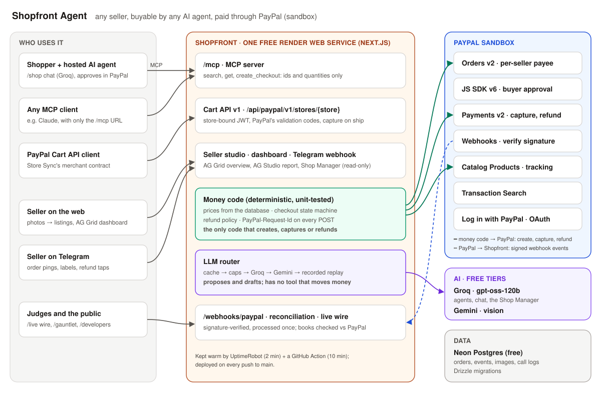

<p align="center"></p>

<h1 align="center">Shopfront Agent</h1>

<p align="center"><b>Any seller, buyable by any AI agent, paid through PayPal.</b></p>

<p align="center">
<a href="https://shopfront-agent.onrender.com"><b>Live demo</b></a> ·
<a href="https://youtu.be/oJgww4Vydew"><b>Demo video</b></a> ·
<a href="#try-it-in-3-minutes">Try it</a> ·
<a href="#how-it-works">How it works</a> ·
<a href="#use-it-from-your-own-agent-mcp">MCP</a> ·
<a href="docs/threat-model.md">Threat model</a>
</p>

Millions of makers sell only through social posts and DMs. They have no store, no product feed and no checkout, so the AI agents people now shop with can't buy from them.

**Shopfront turns a seller's product photos into a PayPal-backed store that any AI agent can buy from over MCP.** The agent picks products, the server sets every price from the database, and **the buyer approves the payment in PayPal**. After the sale, the seller runs the shop from a chat on their phone and an AG Grid dashboard they can talk to.

**No model can move money.** Orders, captures, refunds and tracking are plain, tested code.

<sub>Built for *Build What's Next with PayPal and AI* (2026), Track 1: Merchant Growth AI. Everything runs in the PayPal sandbox; no real money moves. MIT licence.</sub>

[](https://youtu.be/oJgww4Vydew)

## Try it in 3 minutes

Open **https://shopfront-agent.onrender.com**. When PayPal asks you to log in, use the sandbox test buyer (it's also shown, with copy buttons, under every PayPal button):

| Email | Password |
|---|---|
| `sb-kaj47u53384870@personal.example.com` | `6cXh>ZcZ` |

1. **Buy with an agent (60 s).** Go to [/shop](https://shopfront-agent.onrender.com/shop) and tap *"Find me a handmade blue mug under $40 as a gift"*. Pay with the PayPal button in the checkout card. The card turns green: **Payment complete, webhook verified**.
2. **Try to break it (20 s).** Tap **Try to hack the price**: 13 real attacks run against the public endpoints and all are blocked. Then open [/gauntlet](https://shopfront-agent.onrender.com/gauntlet): 31 attacks against a naive shop and against Shopfront, same model. The naive shop takes orders at the attacker's price; Shopfront blocks **31/31**.
3. **Be the seller (90 s).** Open [/studio](https://shopfront-agent.onrender.com/studio) → *Continue as Juniper Clay Studio*. Drop a product photo to get a draft listing, then open *Dashboard → Report · AG Studio* (desktop) and ask the Shop Manager *"Are my payments reconciled with PayPal?"*.

**First visit of the day?** See [what to expect on the free tier](#what-to-expect-on-the-live-demo).

<details>
<summary><b>The full 5-minute path</b> (every step, plus Telegram, the Cart API and the live wire)</summary>

1. **Buy with an agent.** On [/shop](https://shopfront-agent.onrender.com/shop), the progress rail lights up as it happens: **Search → Found → Checkout → PayPal → Paid**, each step labelled with who did it. After you pay, the card shows the PayPal order and capture ids, then "PayPal webhook received and signature verified". The live wire on the right shows every MCP call and PayPal request.
2. **Try to cheat.** The hack card's 13 attacks are price tampering, quantity tricks, fake ids, stolen order tokens, a **forged PayPal webhook** and an oversized request. It ends with *Attacks blocked 13/13 · Price unchanged · Checkouts created 0*, counted in the database. The Gauntlet adds injections **hidden in product photos and shipping-label photos**. *Run the Gauntlet* runs it again live (a minute or two; answers the model gave before are reused and labelled).
3. **Be the seller.** Juniper Clay is a shared demo seller that resets nightly.
   - **Listings:** Gemini drafts the listing from your photo. Fields it filled are marked **AI**, unsure ones say *check it*, and nothing publishes until you confirm the price. Publishing mirrors the product into PayPal's catalog.
   - **Dashboard → Overview** (AG Grid + AG Charts): ask *"unshipped orders over $50 this week"*. The grid, filters and chart change, and a banner lists exactly what changed, with **Undo**. Click an order for its full PayPal history.
   - **Dashboard → Report · AG Studio** (desktop): a five-page report with our own widgets. The **Shop Manager** answers with `[db]` / `[paypal]` figures from read-only tools and refuses *"refund order X"*: it has no tool that moves money.
4. **Run the shop from Telegram.** Open the [judge-mode link](https://t.me/juniper_clay_copilot_bot?start=judge) → *Start* (an isolated practice shop). Tap **🧪 Simulate a buyer**, pay as the test buyer, and the order ping arrives. **Simulate a refund request**: the policy decides, or you get **Approve / Decline**. Send a product photo for a draft, or a shipping-label photo to add tracking to the PayPal order.
5. **Shop through PayPal's Cart API.** On [/developers](https://shopfront-agent.onrender.com/developers), tap *Get a 1-hour token* and paste the curl. The shop answers in PayPal's Cart API v1 schema.
6. **Watch the wire.** [/live](https://shopfront-agent.onrender.com/live) shows 24-hour counts, then every agent step, MCP call, PayPal request and webhook as it happens.
</details>

## How it works



- **Photos → store.** Gemini drafts each listing from a photo and flags text in it that looks like an instruction. The seller confirms the price; publishing mirrors the product into PayPal's catalog.
- **Agents buy over MCP.** One public endpoint serves every seller. Agents send only product ids and quantities; the server prices the order from the database and opens a PayPal Orders v2 order.
- **The buyer approves in PayPal.** Payment happens only in PayPal's popup (JS SDK v6). A signature-verified webhook confirms it, processed exactly once, with a fallback that asks PayPal directly.
- **Each seller paid directly.** Sellers connect with Log in with PayPal; orders carry their `payee`, so money lands in their own PayPal. Shopfront takes no cut.
- **Store-Sync-ready.** Every store also answers PayPal's Cart API v1 merchant contract, tested with PayPal's own Cart API client.
- **After the sale.** A Telegram copilot pings orders, turns a label photo into tracking on the PayPal order, and runs refunds inside the seller's policy (others wait for an Approve tap). An AG Grid + AG Studio dashboard answers questions; the AI changes the view, never the data.
- **Reconciled with PayPal.** Every PayPal capture of the last 30 days is matched against our orders; the dashboard says **Reconciled with PayPal ✓** or lists the mismatches.

It's **one Next.js service on Render's free plan** with a Neon Postgres database. Only the money code (green in the diagram) calls PayPal to create, capture, refund or track, and it reads every price from the database. The LLM router (purple) drafts, suggests and answers, but has no tool that moves money.

### Safety: the model proposes, code decides the money

- **Ids and quantities only.** Every MCP input rejects unknown fields, so `price`, `total` or `discount` never reach a handler.
- **Refunds** are decided by a pure, unit-tested policy engine. The amount comes from the order, the capture is fetched first, and a `PayPal-Request-Id` plus a row lock make a double tap safe.
- **Telegram actions** are single-use, seller-scoped, expiring buttons created by code. A button carries only an id.
- **Untrusted text is data.** Instructions hidden in product photos or buyer messages are flagged or refused. The Gauntlet shows each case next to a naive shop that falls for it.
- **Webhooks** are signature-verified with PayPal, stored once by event id and processed once.

Details: [threat model](docs/threat-model.md) (17 threats, each with its test) · [every PayPal call with debug ids](docs/sandbox-validation.md) · [how it was built with an AI agent](docs/development-with-ai.md).

### PayPal APIs

| API | Used for |
|---|---|
| **Orders v2** | Create (with a per-seller `payee`), capture, GET for fallback checks, add shipment tracking |
| **JS SDK v6** | The buyer's approval step, on `/pay` and inline in the chat |
| **Payments v2** | GET the capture before a refund, refund, GET the refund; authorize, capture on ship and void for Cart API orders |
| **Cart API v1** (Store Sync) | The merchant contract every store implements |
| **Webhooks v1** | Signature verification; capture and order events |
| **Catalog Products v1** | Listings mirrored into PayPal's catalog, with edits written back |
| **Transaction Search v1** | The `[paypal]` figures and the reconciliation |
| **Log in with PayPal** | A seller connects their PayPal; only a verified account is ever paid |
| **OAuth 2.0** | A server-side token with cache and refresh; the client id is the only PayPal value in the browser |

Every POST carries a `PayPal-Request-Id`, and every call's debug id is logged and shown on the timeline.

### AI

Every model call goes through one router: **cache → per-IP and daily caps → primary → fallback → recorded replay**, `temperature: 0`, Zod-validated output. Badges say which source answered each step: "Live · Groq", "Live · Gemini", "Answered before" (cached) or "Replayed recording". If both free providers are down, recorded words are replayed while every PayPal call, price and total stays live.

| Component | Model | Does | Can never |
|---|---|---|---|
| Buyer agent (`/shop`) | Groq `openai/gpt-oss-120b` | Searches over MCP, opens a checkout with ids and quantities | Send a price, approve or pay |
| Photo cataloger | Gemini `gemini-3.5-flash-lite` (vision) | Drafts the listing, flags instruction-like text, suggests a price | Publish or set the price |
| Label reader | Gemini (vision) | Reads carrier and tracking number from a label photo | Add tracking without the seller's tap |
| Dashboard Ask bar | Groq | Turns a question into grid filters, grouping and charts | Change data |
| Shop Manager (AG Studio) | Groq; Gemini for large turns | Answers with read-only tools, asks Studio's page agent to change the layout | Refund, ship, cancel or reprice |
| Seller notes | Groq | Words thank-you, shipping and refund notes | Decide a refund |
| The Gauntlet | Groq, both sides | Plays the naive shop's agent and Shopfront's | — |

## Use it from your own agent (MCP)

One MCP server covers every seller: add it once, shop everyone.

- **Claude (desktop or web):** *Settings → Connectors → Add custom connector*, URL `https://shopfront-agent.onrender.com/mcp`.
- **Any MCP client with Streamable HTTP:** the same URL. No auth; every tool is read-only except `create_checkout`, which only returns a PayPal approval link for a human.
- **Clients that only speak stdio:**

```json
{
  "mcpServers": {
    "shopfront": { "command": "npx", "args": ["-y", "mcp-remote", "https://shopfront-agent.onrender.com/mcp"] }
  }
}
```

Tools: `search_products`, `get_product`, `create_checkout` (variant ids and quantities only), `get_checkout_status`, `request_refund`. Agents can also read [`/llms.txt`](https://shopfront-agent.onrender.com/llms.txt) and schema.org data on every storefront.

<details>
<summary><b>PayPal Cart API v1 (Store Sync)</b>: endpoints, auth, validation, payment</summary>

Every store answers PayPal's Cart API v1, built to PayPal's published schema ([`@paypal/agentic-commerce-spec`](https://www.npmjs.com/package/@paypal/agentic-commerce-spec)), at `https://shopfront-agent.onrender.com/api/paypal/v1/stores/{store}`.

| | |
|---|---|
| **Endpoints** | `POST /merchant-cart` · `GET /merchant-cart/{id}` · `PUT /merchant-cart/{id}` · `POST /merchant-cart/{id}/checkout` |
| **Auth** | A Bearer JWT bound to one store (EdDSA; public key at [`/.well-known/jwks.json`](https://shopfront-agent.onrender.com/.well-known/jwks.json)). A token for one shop gets 403 at another. |
| **Validation** | PayPal's `validation_issues` codes and `resolution_options`, computed from the database. An agent-sent price is never used: a different one comes back as `PRICE_MISMATCH` → `ACCEPT_NEW_PRICE`. |
| **Payment** | Checkout opens an Orders v2 order with `intent: AUTHORIZE`; the buyer approves in PayPal; **adding tracking captures it** (capture on ship). Cancelling before shipping releases the hold. |
| **Proof** | `cart-checks` on Render with real sandbox payments, and a test agent built on PayPal's own Cart API client: `pnpm --filter web cart-agent -- --store juniper_clay --query mug`. |
</details>

## What's real (and verified)

Every feature is an acceptance test run **against the deployed app with real PayPal sandbox calls**, no mocks, and every suite ends by reconciling our books with PayPal's.

<!-- test-counts:start -->
**202/202 unit tests pass** (packages/core 137, packages/llm 11, packages/mcp 9, packages/paypal 10, apps/web 35), and **24 acceptance suites with 148 checks** run against the deployed app with real PayPal sandbox calls: `ag-checks` 19, `approval-checks` 5, `cart-checks` 15, `connect-checks` 5, `dashboard-checks` 7, `fixes-checks` 6, `fixes3-checks` 4, `gauntlet-checks` 4, `hack-checks` 3, `landing-checks` 6, `lane-checks` 3, `live-checks` 5, `mobile-checks` 3, `phase3-checks` 6, `phase4-checks` 6, `phase5-checks` 6, `phase6-checks` 8, `reconcile-checks` 5, `recovery-checks` 4, `review2-checks` 5, `shop-checks` 5, `studio-checks` 5, `telegram-checks` 6, `telegram-flow-checks` 7.

<sub>Generated by `pnpm --filter web test-counts` on 2026-10-25. Per-call PayPal evidence: [docs/sandbox-validation.md](docs/sandbox-validation.md).</sub>
<!-- test-counts:end -->

<details>
<summary><b>What each suite proves, with screenshots and logs</b></summary>

| Area | What it proves | Proof |
|---|---|---|
| Phase 1 | Agent → our MCP → Orders v2 → human approval in PayPal → capture → verified webhook | [GATE-PROOF](docs/screenshots/phase-1/GATE-PROOF.md) |
| Phase 2 | Webhooks processed exactly once, forged ones rejected, a lost webhook *and* a lost capture recovered by a fallback check, restart-safe timers | [AT-2](docs/screenshots/phase-2/AT-2.md) |
| Phase 4 | Policy refunds (100% branch-covered), one-tap seller approval (a double tap refunds once), label photo → tracking on the PayPal order | [AT-4](docs/screenshots/phase-4/AT-4.md) |
| Approval | The PayPal button opens on the first click, 8/8 fresh pages; redirect approval, cancel, refund re-walk | [approval](docs/screenshots/approval/), D-086 |
| /shop | Rail, photo cards, inline PayPal payment → paid state, closing PayPal charges nothing, no sideways scroll | [shop](docs/screenshots/shop/) |
| Dashboard | Real data, no watermark; catalog write-back verified by a PayPal GET; an injection-looking edit refused; Ask → view → Undo; 10 injection prompts change nothing | [dashboard](docs/screenshots/dashboard/), D-089 |
| Studio | A real Gemini draft from a fresh photo; Publish locked until the price is confirmed; publish → live in the storefront and PayPal's catalog | [studio](docs/screenshots/studio/) |
| Hack card | 13/13 real attacks blocked across 6 families; the price matches the DB; 0 checkouts in the DB | [hack](docs/screenshots/hack/), D-091 |
| The Gauntlet | 31 attacks in 7 families against a naive shop and Shopfront, same model: **31/31 blocked**; the naive shop's 14 sandbox orders confirmed by a PayPal GET at the attacker's amount | [gauntlet](docs/screenshots/gauntlet/), D-102 |
| AG Studio report | Five pages match the data API; the Shop Manager's figures re-checked against its tools; a refund request refused; AI changes undone; a missing licence falls back without a watermark | [ag](docs/screenshots/ag/), D-100, D-101 |
| Telegram | Judge mode end to end: simulated buyer paid in PayPal → order ping → refund by policy or tap, photo → Publish, label → Add tracking | [telegram](docs/screenshots/telegram/), D-092 |
| Phase 9 | Each seller paid **directly into their own PayPal**: a real capture paid seller 2; a shop with no verified PayPal is refused before any order | [AT-9](docs/screenshots/phase-9/AT-9.md) |
| Log in with PayPal | A real sign-in verifies Fern & Loom; a replayed sign-in link is refused; the next paid order lands in seller 2's PayPal | [connect](docs/screenshots/connect/), D-092, D-094 |
| Cart API v1 | PayPal's own Cart API client buys through the merchant contract; six bad tokens refused; a $0.01 agent price creates no order; capture on ship; a replayed checkout holds once | [cart](docs/screenshots/cart/), D-097, D-098 |
| Reconciliation | Every capture of the last 30 days matched against our orders. It caught two captures a bug left on cancelled orders (D-094); both were refunded through the app's refund code | [reconcile](docs/screenshots/reconcile/), D-095 |
| Recovery | A verify outage gets 503 (PayPal retries); unprocessed webhooks are swept; a declined card's next capture gets a new `PayPal-Request-Id` | [RECOVERY](docs/screenshots/recovery/RECOVERY.md) |
| Live, landing, mobile | 24 h counts from the DB; the landing; 13 routes × 3 phone widths with no sideways scroll | [live](docs/screenshots/live/), [landing](docs/screenshots/landing/), [mobile](docs/screenshots/mobile/) |
</details>

<details>
<summary><b>How each judging criterion is met</b></summary>

| Criterion | Where to look |
|---|---|
| **Technological implementation** | Orders v2, JS SDK v6 and verified webhooks processed exactly once; payee routing to each seller; Catalog write-back; Transaction Search, tracking and refunds; a strict-schema MCP server; a guarded LLM router; every phase tested against the deployed app with real sandbox calls. |
| **Design** | Craft retail for sellers, a live-ops console for the wire; a purchase rail that shows who acts at each step; an AG Grid dashboard where every AI change is visible and undoable; 13 routes checked at 360/390/430 px. |
| **Potential impact** | A seller with only a phone and a PayPal account becomes buyable by every AI agent through one endpoint, paid directly into their own PayPal, with post-sale chores handled from Telegram. |
| **Innovation** | Agentic commerce where the model proposes and code decides the money; the seller's own agent runs operations through single-use buttons; natural language changes the grid's view, never its data. |
| **Presentation** | The [demo video](https://youtu.be/oJgww4Vydew), the 5-minute path above, `/live` with real PayPal ids, and the proofs. |
| **Best Use of AG Grid** | A five-page **AG Studio** report on six joined data sources (KPI sparklines, combo, donut, stacked columns, radial gauge, pivot grid) in Shopfront's theme; **custom widgets** (PayPal reconciliation, the Cart API funnel, the live agent wire, the refund queue, an editable ledger); a custom **Shop Manager** agent on Studio's Agent Framework that delegates layout to Studio's page agent, with an "AI" change strip and one-step Undo; an AG Grid overview with drill-down, live rows, inline edits and a linked AG Charts chart. |
</details>

## Scope and design choices

- **Sandbox by design.** Everything runs on PayPal's sandbox with US accounts, so anyone can try a real payment flow without spending money. The PayPal client refuses a live base URL.
- **Two ways to get paid.** A seller who connects with Log in with PayPal is paid **directly into their own PayPal** (Fern & Loom shows this). The demo shop, Juniper Clay, is paid into the platform's sandbox account so any judge can buy from it with no setup; Log in with PayPal on that shop shows the check working without rerouting its payments. A shop without a verified PayPal account is refused before any order is created.
- **Built to grow into PayPal's partner tier.** Partner onboarding, platform fees and refunding a payment that landed in another seller's account are reserved for approved PayPal partners (D-075, D-076). Shopfront takes no fee, and a direct-paid seller's refund is a one-tap handoff to their own PayPal that our verified webhook then marks done.
- **Store Sync: built and tested, waiting on PayPal's routing.** PayPal sends Store Sync traffic and issues merchant tokens after its request-access onboarding. Until then, Shopfront issues its own store-bound tokens, and the token check is the one place PayPal's tokens would plug in.
- **Capture on ship.** Cart API orders are authorized at checkout and captured when tracking is added. PayPal honors an authorization for 3 days, so sellers are reminded to ship within 3 days.
- **Every figure names its source.** PayPal's Transaction Search can lag about 3 hours, so today's numbers come from our database and are labelled `[db]`, and PayPal's are labelled `[paypal]`. Reconciliation covers the newest payments with verified webhooks and a direct GET of each capture.
- **Reconciliation** runs every night from a scheduled GitHub Action, on every start-up, after every test suite, and whenever the dashboard finds the last run more than a day old. It reports mismatches; refunding a stray capture is a separate operator action through the normal refund code.
- **AG Grid licences.** AG Studio runs on its trial licence. The Overview tab runs on AG Grid Community with our own grouping and drill-down, and switches Enterprise features on when a key is set. Without a valid key you get the Community view, never a watermark.
- **Next on the list:** dispute handling and saved-wallet reorders with PayPal Vault. They aren't in this build.
- **Listing photos** are public-domain museum pieces standing in for the sellers' work; the five photos in `docs/demo-photos/` are AI-generated stand-ins.

## What to expect on the live demo

- **Free tiers, with fallbacks.** Render cold starts (about 1 minute), Groq's 8k tokens per minute, Gemini latency. Answers are cached, and the demo can replay.

## Run it locally

You need Node 22+, pnpm 10, a Postgres database (Neon free works), a PayPal **sandbox** REST app (US business account), and free Gemini and Groq API keys.

```bash
pnpm install
cp .env.example .env          # fill in the values (see docs/SETUP.md)
pnpm --filter @shopfront/db db:migrate
pnpm --filter web seed        # demo sellers, products and their photos
pnpm build && pnpm start      # http://localhost:3000
```

Keep the one `.env` at the repo root. PayPal can't deliver webhooks to `localhost`, so locally a payment is confirmed by the fallback check that asks PayPal directly (badge "via poll").

Tests: `pnpm test` (unit), `pnpm typecheck`, `pnpm lint`. Acceptance suites run against a deployment: `pnpm --filter web <name>-checks -- --base <url>`.

<details>
<summary><b>Project structure</b></summary>

```
apps/web/
├── src/app/                 Next.js routes: /shop, /pay, /s/[handle], /studio, /gauntlet, /developers, /live
│   ├── mcp/                 the public MCP server (Streamable HTTP)
│   ├── api/paypal/v1/       PayPal Cart API v1 merchant endpoints, per store
│   ├── webhooks/paypal/     signature-verified PayPal webhooks, processed once
│   └── telegram/webhook/    the seller copilot (secret-token verified)
├── src/components/          UI: shop chat, PayPal approval, studio, AG Grid overview, AG Studio report + widgets
├── src/server/              orders, captures, refunds, tracking, catalog, reconciliation, the Gauntlet, Telegram
└── scripts/                 acceptance suites run against the deployment (*-checks), seed, test counts
packages/
├── core/                    money, pricing, checkout state machine, refund policy, payout routing, Zod contracts
├── paypal/                  thin typed PayPal REST client (OAuth cache, PayPal-Request-Id, debug ids, retries)
├── llm/                     provider-agnostic LLM router (cache → caps → primary → fallback → replay)
├── mcp/                     MCP tool contracts (ids and quantities only) + handlers
└── db/                      Drizzle schema + SQL migrations (Neon Postgres)
video/                       Remotion project for the demo video; assets and licences in video/ASSETS.md
docs/                        requirements (frozen), decisions, plan, threat model, sandbox validation, test evidence
```
</details>

## Built with

Groq (`openai/gpt-oss-120b`, free tier) · Google Gemini (`gemini-3.5-flash-lite`, free tier) · Vercel AI SDK · AG Grid, AG Charts, AG Studio · Model Context Protocol · Telegram Bot API · Next.js · Drizzle · Neon Postgres · Render · Playwright

## Credits

- **Listing photos:** public-domain museum photographs (**CC0 1.0**) from the Art Institute of Chicago, LACMA, The Metropolitan Museum of Art and rawpixel, found through Openverse. Sources and licences: [`apps/web/seed-photos/CREDITS.md`](apps/web/seed-photos/CREDITS.md). The bud-vase image is our composite of three of them. The photos in [`docs/demo-photos/`](docs/demo-photos/) are AI-generated stand-ins (made with ChatGPT).
- **Fonts:** Alegreya and Geist (SIL Open Font License), via Google Fonts.
- **Demo video:** voice by ElevenLabs; music "The Budding of Consciousness" by Yoiyami (CC0); click sound by Kenney (CC0).

## License

[MIT](LICENSE)
